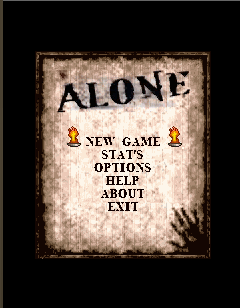
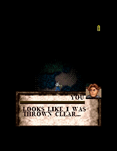
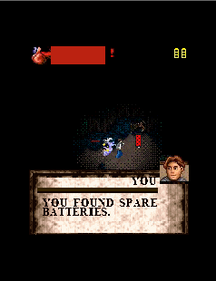
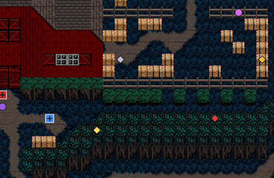

# Alone: The Horror Begins — J2ME restoration

A playable **MIDP 2.0 / CLDC 1.1** restoration of the lost Centerscore mobile
game **Alone: The Horror Begins**, rebuilt from a 3,823-frame video capture of
the original demo.

The project targets **176×208 SE** screens and runs on old phones as well as
the Sun Wireless Toolkit emulator. **Current version: 1.0.3.**

| Menu | Cutscene | Pickup | Map editor |
| --- | --- | --- | --- |
|  |  |  |  |

## What was made

- **A complete J2ME engine** — 176×208 game loop, scene manager, tile-world
  renderer, collision, lighting/flashlight masks, enemies, combat, inventory
  flags, dialogue system, HUD, RMS save/load and a full menu flow
  (logo → title → menu → options → level card → loading → gameplay).
- **Three restored chapters**:
  - **Chapter 1** — the crashed plane in the woods; ends by talking to Jonathan.
  - **Chapter 2** — the right-to-left mountain path; zombies appear and the
    chapter ends when the player reaches the left side.
  - **Chapter 3** — the barn at the end of the road; take the crowbar and open
    the red doors to reach the demo ending.
- **Recovered map and tile system** — all terrain was reconstructed from the
  demo capture, finalised as an 8×8 tile grid atlas
  (`res/tileset_grid.png`) and exported as compact big-endian `.jmap` maps.
- **A map SDK / editor** — `sdk-map-editor/` contains an offline browser map
  studio for terrain, collision, spawn points, items, enemies and story
  triggers. Open `sdk-map-editor/editor/index.html` directly; the bundle
  embeds the atlas, maps and the full object palette.
- **A unified game-object catalog** — items, enemies and triggers are defined
  once in `sdk-map-editor/assets/game_objects.json` so the editor and maps use
  the same ids.
- **A restoration ending screen** with project credits.

## Current status / needs work

The demo is playable from start to the chapter-3 ending, but this is still a
restoration in progress:

- **Bug fixing** — edge-case collision, pickup ranges, trigger retries and
  save/load state.
- **Animation fixing** — player/enemy walk cycles, attack feedback and scene
  transitions; some frames are still approximations.
- **Plot fixing** — the recovered dialogue is partial. Some scenes are
  reconstructed from the capture and need verification or expansion when new
  material is found.

## Version 1.0.3

- Howlers now react to the actual flashlight pool, retreat even while attacking,
  cannot damage the player during the retreat and die reliably after it.
- MIDI players are cached and prefetched once, so several howlers/zombies
  sounding at the same time no longer freeze the game.

## Version 1.0.2

- Tank controls: `4`/`6` rotate the player, `2` moves forward and `8` backward.
- Main theme (`main_theme.mid`) loops from the first logo until gameplay; it
  restarts when the player returns to the main menu.
- MIDI stingers: `game_over.mid` (6-second GAME OVER screen), `zombie.mid` (max
  once per 3 seconds), `howler1/2.mid` (invisible howler) and
  `enemy_death.mid`.
- New enemy sheets: 10-frame `howler_full.png`, 4×4 `zombie_full.png` and the
  8-frame `death_full.png` death sequence.
- Howlers fly through walls, ignore weapons, flee a facing flashlight and die
  after retreating about three tiles.
- Pause menu uses `page_pause.png` and the campfire sits 10 px higher.
- `1` and `3` both toggle the flashlight; only `*` opens the pause menu.
- MIDlet vendor set to **Centerscope ritsudo**.

## Version 1.0.1

- New 8-direction player walk sheet (`res/player_walk.png`, 6 frames × 14×25 px
  per direction).
- Directional flashlight pool that persists when the player stops.
- Removed the old `res/player.png` 3-pose sheet.

## Controls

| Key | Action |
| --- | --- |
| `4` / `6` or Left/Right | Rotate the player |
| `2` / `8` or Up/Down | Move forward / backward |
| `5` / Fire | Interact, pick up, attack, shoot |
| `1` / `3` | Toggle flashlight (when owned) |
| `*` | Pause |
| Right soft key | Back / cancel |

## Build

Requirements:

- **32-bit JDK 1.8**
- **Sun WTK 2.5.2** (for `preverify`, CLDC/MIDP APIs and the emulator)
- Python 3 + Pillow/numpy only for the asset/map tools

Edit the two toolchain paths at the top of `build.ps1` if they differ:

```powershell
$JDK = "D:\Java\jdk1.8.0_131\bin"
$WTK = "D:\Java\WTK2.5.2_01"
```

Build the MIDlet:

```powershell
powershell -ExecutionPolicy Bypass -File build.ps1
```

Outputs:

- `bin/AloneTheHorror.jar`
- `bin/AloneTheHorror.jad`

> The WTK emulator can be memory-hungry; run it only on a machine with enough
> RAM. `build.ps1 -Run` builds and launches it.

## Map / asset pipeline

The final recovered data lives in the SDK:

```
sdk-map-editor/assets/tileset_grid.png   final 8x8 tile atlas
sdk-map-editor/assets/tileset_grid.json  tile ids, kinds, collision
sdk-map-editor/assets/game_objects.json  items, enemies, triggers
sdk-map-editor/maps/chapter*.jmap        source maps
sdk-map-editor/editor/                   offline map studio
```

Publish the SDK maps/assets to the game and regenerate the editor bundle:

```powershell
python tools\integrate_final.py
powershell -ExecutionPolicy Bypass -File build.ps1
```

`integrate_final.py` keeps the final terrain untouched, adds the required
story triggers when missing, copies the maps/atlas to `res/`, and rebuilds
`sdk-map-editor/editor/bundle.js`.

### Story trigger ids

| Id | Name | Purpose |
| ---: | --- | --- |
| `4608` | `player_spawn` | Red spawn marker |
| `4609` | `level_exit` | Ends the chapter |
| `4611` | `cutscene` | `param` selects a `Script.java` dialogue table |
| `4612` | `talk_jonathan` | Chapter 1 ending |
| `4613` | `door_crowbar` | Chapter 3 ending; requires the crowbar |

The editor object inspector lets you edit an object’s type, position,
`param` and flags, so cutscenes, spawns, pickups and endings can be placed
without touching code.

## Project layout

```
src/             24+ Java classes (engine, scenes, world, script)
res/             MIDlet resources (tileset, maps, sprites, fonts, UI)
sdk-map-editor/  offline map SDK, final atlas/maps, editor bundle
tools/           asset/map generation and integration scripts
docs/            architecture, asset notes and progress history
screenshots/     demo screenshots used in this README
bin/             built JAR/JAD
```

Technical notes:

- Classes are in the default package; the MIDlet class is `horror`.
- Maps use the small `JMAP` format: RLE terrain/collision layers plus 10-byte
  object records, easy to parse on CLDC devices.
- Terrain tile id `N` maps to `sx = (N % 8) * 16`, `sy = (N / 8) * 16` in
  `tileset_grid.png`.

## Credits

- Original game: **Centerscore** — *Alone: The Horror Begins*.
- Restoration, engine, map recovery and SDK: **ritsudo**.
- This is a non-commercial fan preservation/demo project. If you have new
  screenshots, recordings or materials from the original game, contributions
  are welcome.

> “This is a demo restoration of the original game in 2026, made by ritsudo.
> If you have any new screenshots, materials of the game feel free to add them
> on my GitHub. Thanks for playing.”
